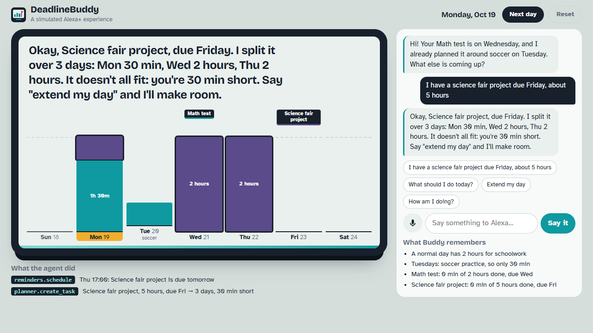

# DeadlineBuddy

**A simulated Alexa+ experience for students: say what's due, and it plans every day before the deadline, remembers your week, and re-plans when you fall behind.**

Live demo: https://tomerbot.github.io/deadlinebuddy/ · Demo video: https://www.youtube.com/watch?v=mOxur8U-hkM



## What it does
- **Say it like you'd say it to Alexa.** "I have a science fair project due Friday, about 5 hours." Buddy works out the task, the deadline and the time it needs (or makes a sensible guess and tells you).
- **Plans the week on the display.** Earliest deadline first, spread evenly over the days before it's due, never more than your daily limit. The week strip shows every block and a flag on each deadline.
- **Remembers you across sessions.** Busy days ("remember I have soccer on Tuesdays"), your daily limit and your progress are saved, so it greets you with "welcome back" and today's plan.
- **Negotiates when it doesn't fit.** If the work can't fit before the deadline it says how short you are and offers a fix ("extend my day").
- **Re-plans on its own.** When the simulated clock moves to the next day, anything you skipped is moved to the days left, and Buddy speaks first.
- **Shows its work.** Every tool the agent calls (`planner.create_task`, `memory.set_busy_day`, `reminders.schedule`, ...) appears in the "What the agent did" panel.

## Try it
Open the live demo, or run it locally (no build step, no API keys):

```bash
python -m http.server 8000
# then open http://localhost:8000/index.html?date=2026-10-19
```

Things to say: "What should I do today?", "I finished studying for the math test", "Remember I have piano on Thursdays", "How am I doing?", "Cancel the math test". Press **Next day** to move the simulated clock. Voice input works in Chrome and Edge (mic button); replies are read aloud with the browser's speech voice.

URL options: `?date=YYYY-MM-DD` sets the simulated today, `?fresh` starts from the example week, `?quiet` turns off spoken replies.

## How it works
| File | What's inside |
|---|---|
| `agent.js` | Understands what you say (pattern-based, runs offline), the planner (earliest-deadline-first, 15-minute blocks, per-day capacity), and the tools the agent calls. Each tool has a name, input and result, shaped like MCP tools. |
| `app.js` | The smart-display screen, the week strip, the conversation, the agent trace, voice in/out, saving to `localStorage`. |
| `style.css` | The display design (see `DESIGN.md`). |

This is the **simulated Alexa+ experience** path of the Alexa+ track: it runs fully in the browser. Because the tools are already MCP-shaped, the next step is serving them from a self-hosted MCP server so the real Alexa+ can call them.

## Built with
HTML, CSS and JavaScript (no framework), Web Speech API, localStorage, a service worker for offline use. Built with help from Claude (Anthropic) as a coding assistant.

## License
MIT, see `LICENSE`.
